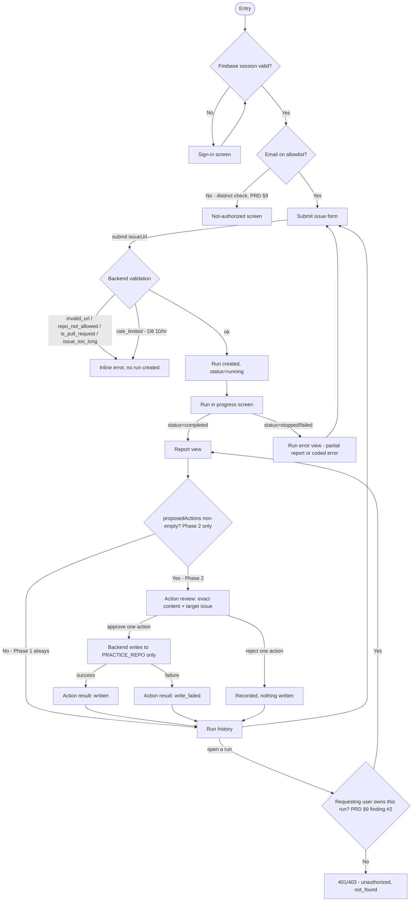

# AppFlow — IssueScout

> **Current frontend decisions (October 14, 2026):** See [PAGE-COMPOSITION.md](PAGE-COMPOSITION.md) for the page contract. Public Google signup replaces invitation-only access. Submission is synchronous, not a polling flow. The current build is read-only; future write-back screens are not implemented. The white/silver translucent design follows the user’s updated direction. These decisions supersede conflicting statements below.

**Author:** Starscream (PRD Writer)
**Date:** 2026-10-08
**Status:** Draft
**Companion to:** `PRD.md` §5 (User Flows)

> Full-tier project. PRD §5 narrates the primary persona's happy path in prose; this document maps the actual navigation structure — every screen, every transition, every branch point, including the Phase 1/Phase 2 split and the auth gate PRD §9 requires. Screen/route names are proposed for Ivaylo (frontend owner, not yet started) to adopt or rename at build time; the branch logic is the binding part, not the exact names.

---

## Screen Inventory

| Screen | Route/Path | Primary persona(s) | Purpose |
|---|---|---|---|
| Sign-in | `/signin` | Maintainer | Firebase Auth sign-in entry point |
| Not-allowlisted | `/not-authorized` | Maintainer (rejected) | Shown when signed in but email fails the allowlist check — distinct from sign-in failure |
| Submit issue | `/` (home, authenticated) | Maintainer | Issue URL submission form |
| Run in progress | `/runs/:id` (status=running) | Maintainer | Polling/loading state while the harness runs |
| Report view | `/runs/:id` (status=completed) | Maintainer | Full `Report` rendered as plain escaped text |
| Run error view | `/runs/:id` (status=stopped\|failed) | Maintainer | Partial report or coded error, plain-language message |
| Run history | `/runs` | Maintainer | List of past runs, newest first, each entry owned-filtered |
| Action review (Phase 2) | `/runs/:id` (actions panel) | Approver | Exact label names / full comment text + target issue, before approve/reject |
| Action result (Phase 2) | `/runs/:id` (post-decision) | Approver | Write result (written/failed) per action |
| Eval results (Phase 3) | `/evals/:id` | Owner (dev-facing) | Per-case expected/actual/pass-fail view |

## Flow Diagram

## Branch Points

| Branch point | Condition | Paths |
|---|---|---|
| Firebase session validity | Is there a valid signed-in session? | Signed in → allowlist check; not signed in → Sign-in screen |
| Allowlist membership (PRD §9, Red-Alert finding #1) | Is the signed-in email on the allowlist? | Allowed → Submit issue form; not allowed → Not-authorized screen (explicitly distinct branch from the sign-in check, not a fallthrough of it) |
| Input validation outcome | `invalid_url` / `repo_not_allowed` / `is_pull_request` / `issue_too_long` / `rate_limited` vs. valid | Invalid → inline error, no run row created, no model call; valid → run created |
| Run outcome | `completed` vs. `stopped`/`failed` | Completed → Report view; stopped/failed → Run error view with partial report or coded error, never blank (PRD §9 Reliability) |
| Resource ownership on `/runs/:id` (PRD §9, Red-Alert finding #2) | Does the requesting user own this run? | Owner → Report/Action view; not owner → `unauthorized`/`not_found`, never the run's content |
| Proposed actions present (Phase 2 gate) | Is `proposedActions` non-empty? | Phase 1: always empty → straight to history; Phase 2: non-empty → Action review screen |
| Approve vs. reject (Phase 2) | Per-action decision, one approval covers one action | Approve → backend writes to `PRACTICE_REPO` only, records who/when; reject → recorded, nothing written |
| Write outcome (Phase 2) | Did the write to `PRACTICE_REPO` succeed? | Success → Action result: written; failure → status `failed`, error `write_failed`, shown to user |

---

## Relationship to PRD §5

PRD §5 stays as the narrative for the primary persona's happy path. This document is the map, including branches PRD §5's prose only gestures at (the two-check auth gate, the per-run ownership check, the Phase 2 action-review split). If they disagree, this document wins for anything build-facing.
