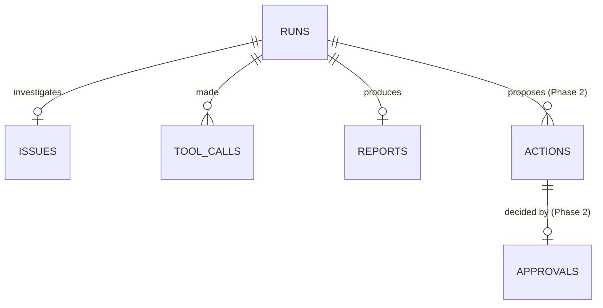

# Backend Schema — IssueScout

**Author:** Alpha Trion (Project Assembly)
**Date:** 2026-10-08
**Status:** Approved (per Build Spec §0/§9 — "treat as fixed unless an owner changes it")
**Companion to:** `TRD.md` §2 (Architecture) and §3 (Interface Contracts); PRD §9 (Security — RLS requirement)

> Full-tier project. Single source of truth for the data model — Shockwave's specs and Wheeljack's data-layer code both trace back to this file, not to each other's inventions. Columns and table set are lifted verbatim from Build Spec §9. This cycle builds the four Phase-1 tables only (`runs`, `issues`, `tool_calls`, `reports`); `actions`, `approvals`, `eval_results` are documented here for contract completeness since Build Spec §9 defines all seven now, but are **not created this cycle** — see the Phase gating note per table.

---

## Tables

All tables: primary keys are UUIDs, all have `created_at`. Postgres, hosted on Supabase.

### `runs`

**Purpose:** One row per triage attempt — the top-level record of "a user submitted this issue URL, here's what happened." Everything else (`issues`, `tool_calls`, `reports`) hangs off this row's `id`.

**Phase: 1 — built this cycle.**

| Column | Type | Constraints | Why |
|---|---|---|---|
| `id` | uuid | PK, default `gen_random_uuid()` | Run identity; referenced by every child table and by `GET /api/runs/:id`. |
| `user_id` | text/uuid (match auth provider's ID shape) | NOT NULL, indexed | **The ownership column.** Every per-resource authorization check (TRD §5, PRD §9 finding #2) filters on this. Not nullable — a run with no owner can't be IDOR-checked. |
| `issue_url` | text | NOT NULL | The raw submitted URL, stored for audit/debugging before any parsing. Not the parsed `owner/repo/number` — those live on the `issues` row once fetch succeeds. |
| `status` | text (enum: `running`, `completed`, `stopped`, `failed`) | NOT NULL, default `running` | Drives which view the frontend shows (APPFLOW.md: Run in progress / Report view / Run error view) and is the reliability signal for PRD §4's "run completion rate" metric. |
| `stop_reason` | text (enum: `completed`, `search_limit`, `read_limit`, `turn_limit`, `time_limit`, `tool_failure`), nullable | — | Populated from `coverage.stopReason` on completion/stop. Nullable because a `failed` run (e.g., `invalid_url` before any harness turn) may never reach the stop-reason-assigning step. |
| `error_code` | text, nullable | — | One of the Build Spec §6 error codes, set when `status = failed`. Nullable on success. |
| `searches_used` | integer | NOT NULL, default 0 | Harness counter, mirrors `coverage.searchesRun` — kept on `runs` (not only inside the `reports.report` jsonb) so it's queryable without parsing jsonb, e.g. for the rate-limiting/metrics work in PRD §4. |
| `reads_used` | integer | NOT NULL, default 0 | Harness counter, mirrors `coverage.candidatesRead`. Same queryability reasoning. |
| `model_turns_used` | integer | NOT NULL, default 0 | Drives/confirms `MAX_MODEL_TURNS` enforcement; useful for debugging a run that hit `turn_limit`. |
| `duration_ms` | integer, nullable | — | Wall-clock run time; null until the run finishes. Used against `MAX_RUN_SECONDS` and for the "did this get close to the limit" observability question. |
| `finished_at` | timestamptz, nullable | — | Null while `status = running`. Set exactly once, at the same moment `status` transitions away from `running`. |
| `created_at` | timestamptz | NOT NULL, default `now()` | Standard. Also the natural sort key for `GET /api/runs?limit=` ("newest first"). |

### `issues`

**Purpose:** The parsed, fetched GitHub issue identity for a run — not its full content (see the "no issue bodies/comments stored outside report evidence" rule below), just enough to identify which issue this run was about and whether it's still in the same state GitHub reports now vs. at retrieval time.

**Phase: 1 — built this cycle.**

| Column | Type | Constraints | Why |
|---|---|---|---|
| `id` | uuid | PK | Row identity. |
| `run_id` | uuid | FK -> `runs.id`, NOT NULL, indexed | One issue per run (Build Spec §1: "one issue per run") — this FK is what makes that invariant checkable (a run should have exactly one `issues` row, never zero after a successful fetch, never more than one). |
| `repo` | text | NOT NULL | Always `APPROVED_REPO`'s value (`calcom/cal.diy`) in Phase 1 — stored explicitly rather than assumed, so a future multi-repo change (not planned, but not architecturally foreclosed) doesn't require a schema migration to even notice it happened historically. |
| `number` | integer | NOT NULL | The GitHub issue number — identifies the issue within `repo`. |
| `title` | text | NOT NULL | Denormalized from GitHub at retrieval time, for display in run history without re-fetching GitHub. |
| `state` | text | NOT NULL | GitHub's issue state (`open`/`closed`) *as retrieved* — a snapshot, not live; `retrieved_at` makes the staleness explicit. |
| `url` | text | NOT NULL | The canonical GitHub issue URL, for the evidence/citation UI (DESIGN-BRIEF.md §3's evidence citation component). |
| `retrieved_at` | timestamptz | NOT NULL | When the harness fetched this issue — distinct from `created_at` (row insert time) in case those ever diverge, and matches `Report.issue.retrievedAt` in the API contract (TRD §3.1). |
| `created_at` | timestamptz | NOT NULL, default `now()` | Standard. |

### `tool_calls`

**Purpose:** An audit trail of every GitHub `read`/`search` call the harness made during a run — the evidence that coverage claims (`searchesRun`, `candidatesRead`, etc.) are backed by something real, and the debugging trail when a run fails or hits a limit.

**Phase: 1 — built this cycle.**

| Column | Type | Constraints | Why |
|---|---|---|---|
| `id` | uuid | PK | Row identity. |
| `run_id` | uuid | FK -> `runs.id`, NOT NULL, indexed | Every tool call belongs to exactly one run; this is the join SCHEMA consumers use to reconstruct "what did the harness actually do during run X." |
| `operation` | text (`read` \| `search`) | NOT NULL | Which of the two model-facing operations this was (TRD §3.3) — never a write operation value, by construction in Phase 1 (no write code path exists to produce one). |
| `arguments` | jsonb | NOT NULL | What was actually requested (e.g., search query text, or which issue number was read) — needed to debug "why did the model's 2nd search look odd" without re-running anything. |
| `outcome` | text (`ok` \| `error` \| `refused`) | NOT NULL | `refused` specifically means "the harness declined this call because a limit was already hit" (Build Spec §8.1 step 5) — distinct from `error` (GitHub itself failed/timed out). Keeping these distinct is what makes `coverage.searchesFailed` (a true GitHub failure) distinguishable from a harness-side refusal, which matters for PRD §4's "failure transparency" metric. |
| `error_code` | text, nullable | — | Populated when `outcome = error`; one of the short, plain error identifiers surfaced to the model (Build Spec §8.2 — never raw errors). |
| `duration_ms` | integer, nullable | — | Call latency; useful for diagnosing `REQUEST_TIMEOUT_SECONDS` near-misses. |
| `created_at` | timestamptz | NOT NULL, default `now()` | Standard; also gives call ordering within a run. |

### `reports`

**Purpose:** The final triage output for a run — the full `Report` shape (TRD §3.1), stored once per completed/stopped run. This is the one place quoted third-party GitHub text legitimately lives (inside `evidence[].observation` / `relatedIssues[].similarities` etc.) — see the retention note below.

**Phase: 1 — built this cycle.**

| Column | Type | Constraints | Why |
|---|---|---|---|
| `id` | uuid | PK | Row identity. |
| `run_id` | uuid | FK -> `runs.id`, NOT NULL, UNIQUE, indexed | One report per run, at most — `UNIQUE` makes "a run somehow got two reports" a constraint violation instead of a silent data-quality bug. |
| `report` | jsonb | NOT NULL | The full `Report` object (TRD §3.1) exactly as returned to the client — `ModelReport` fields plus harness-written `issue`/`coverage`. Stored as jsonb (not split into columns) because the shape is a fixed TypeScript contract already validated by zod before it ever reaches this insert; splitting it into columns would just be a second, redundant place that contract could drift. |
| `created_at` | timestamptz | NOT NULL, default `now()` | Standard. |

**Hard rule carried from Build Spec §9, binding on this table specifically:** do not store issue bodies or comments anywhere outside `report`'s own evidence fields. There is no `issues.body` or `issues.comments` column, by design (see the `issues` table above) — this is enforced by the schema's shape, not left to application-code discipline alone.

### `actions` *(Phase 2 — not created this cycle)*

**Purpose:** A proposed GitHub write (add labels or post a comment) attached to a report, awaiting or past an approval decision.

| Column | Type | Constraints | Why |
|---|---|---|---|
| `id` | uuid | PK | Row identity. |
| `run_id` | uuid | FK -> `runs.id`, NOT NULL | Which run's report this action was proposed from. |
| `kind` | text (`add_labels` \| `post_comment`) | NOT NULL | Matches `ModelReport.proposedActions[].kind`. |
| `content` | jsonb | NOT NULL | The exact labels array or comment body proposed — must match what the frontend shows the approver verbatim (Build Spec §8.2: "frontend MUST show the exact labels, the full comment text... before the user can approve"). |
| `status` | text (`pending`, `approved`, `rejected`, `written`, `failed`) | NOT NULL, default `pending` | Lifecycle state; `written`/`failed` only reachable after an `approvals` row exists for this action. |
| `write_result` | jsonb, nullable | — | GitHub's confirmation or error from the actual write call, once attempted. |

*Not created this cycle — Phase 2 is blocked on D4/D5 per PRD §10. Listed here so SCHEMA.md stays the single forward-looking reference instead of needing a second document when Phase 2 starts.*

### `approvals` *(Phase 2 — not created this cycle)*

**Purpose:** The recorded human decision on exactly one `actions` row — who decided, what, and when. This table is what makes "one approval covers one action, enforced in backend code" (Build Spec §8.2) auditable after the fact, not just true at write-time.

| Column | Type | Constraints | Why |
|---|---|---|---|
| `id` | uuid | PK | Row identity. |
| `action_id` | uuid | FK -> `actions.id`, NOT NULL, UNIQUE | One approval per action — `UNIQUE` enforces "one approval covers one action" at the schema level, not just in application logic. |
| `user_id` | text/uuid | NOT NULL | Who decided — the Approver persona (PRD §2). |
| `decision` | text (`approve` \| `reject`) | NOT NULL | The decision itself. |
| `edited_content` | jsonb, nullable | — | If the approver edited the proposed content before approving (e.g., trimmed a comment) — null means "approved/rejected as-proposed." |
| `decided_at` | timestamptz | NOT NULL | When the decision was made — distinct from `created_at` only if those could ever differ; kept explicit per Build Spec §9's literal column list. |

*Not created this cycle.*

### `eval_results` *(Phase 3 — not created this cycle)*

**Purpose:** Per-case results from running the fixture set against the pipeline (PRD §4's metrics, automated instead of hand-graded).

| Column | Type | Constraints | Why |
|---|---|---|---|
| `id` | uuid | PK | Row identity. |
| `eval_run_id` | uuid | NOT NULL | Groups all cases from one `POST /api/evals/run` invocation. |
| `case_id` | text | NOT NULL | Identifies which fixture case this result is for (e.g., maps to T1-T10's fixture IDs). |
| `expected` | jsonb | NOT NULL | The hand-written expected output for this fixture. |
| `actual` | jsonb | NOT NULL | What the pipeline actually produced. |
| `passed` | boolean | NOT NULL | Deterministic comparison result — computed in code, never asserted by a model (BOUNDED-AI rule: scores/comparisons are deterministic, a model may narrate but never produce the pass/fail number itself). |

*Not created this cycle.*

---

## Relationships

| From | To | Cardinality | Meaning |
|---|---|---|---|
| `issues.run_id` | `runs.id` | 1:1 (at most one issue row per run, in Phase 1's "one issue per run" design) | The single GitHub issue this run investigated. |
| `tool_calls.run_id` | `runs.id` | N:1 (many tool calls per run) | Every GitHub `read`/`search` the harness made during this run. |
| `reports.run_id` | `runs.id` | 1:1 (UNIQUE constraint) | The one final report this run produced, if it got that far. |
| `actions.run_id` | `runs.id` | N:1 (Phase 2 — a report can propose up to two actions: one `add_labels`, one `post_comment`, per Build Spec §5's union type) | Which run's report this proposed action came from. |
| `approvals.action_id` | `actions.id` | 1:1 (UNIQUE constraint, Phase 2) | The one decision recorded for this one action. |
| `eval_results.eval_run_id` | (no FK table in Phase 1-2; conceptual grouping key, Phase 3) | N:1 | All per-case results from one eval invocation. |

## Entity-Relationship Diagram

## Indexes & Performance Notes

Scale is ~2-3 concurrent allowlisted users, one issue per run, `RUNS_PER_USER_PER_HOUR=10` (PRD §9 Scalability) — this is explicitly not a high-concurrency design target, so the index list below is the minimum that actually matters for the two real access patterns, not a blanket index-everything list, per `~/.claude/skills/perf-triage/SKILL.md`'s Tier classification (this is Tier 3 — low volume, no hot-path risk — for everything except the two rows below).

| Table | Index | Why |
|---|---|---|
| `runs` | `(user_id, created_at DESC)` | Backs both real query patterns: `GET /api/runs?limit=` (list *my* runs, newest first) and the per-resource ownership check on `GET /api/runs/:id` (`WHERE id = :id AND user_id = :userId`) benefits from `user_id` being indexed even though the lookup itself is by PK. This is the one genuinely load-bearing index in Phase 1 — it's also the query that enforces the IDOR protection (PRD §9 finding #2), so a missing index here is a correctness-adjacent concern (a full-table-scan ownership check still returns the right answer, but as data grows this is the first thing worth confirming with `EXPLAIN ANALYZE` per the `postgresql` skill, not something to guess about). |
| `tool_calls` | `(run_id)` | Every read of this table is "all tool calls for run X" (audit/debug view) — never a cross-run query in this design. |
| `issues` | `(run_id)` | Same reasoning — always looked up by run. |
| `reports` | `(run_id)` UNIQUE | Enforces the 1:1 cardinality and backs the one lookup pattern (fetch the report for this run). |

---

## Row Level Security (PRD §9 finding #4 — required, not optional, despite the service-role-key bypass)

RLS policies MUST be defined on all seven tables listed above (four built this cycle, three Phase 2/3 — define policies for all seven now since the table *contract* is fixed even though three tables aren't created yet; when they are created in a later cycle, their RLS policies should already be decided here, not re-derived).

**Policy shape, Phase-1 tables:**

- `runs`: `SELECT`/`INSERT`/`UPDATE` allowed only where `user_id = auth.uid()` (or the equivalent claim from whatever sits behind the Firebase-placeholder auth interface — TRD §5 notes this is pending Ivaylo's confirmation). No `DELETE` policy — nothing in Phase 1 deletes a run.
- `issues`, `tool_calls`, `reports`: no direct `user_id` column (they relate to `runs` by `run_id`), so their policy is a subquery: allowed only where the referenced `runs.user_id = auth.uid()`. This is why the `runs.user_id` index above also indirectly backs these tables' RLS policy performance.

**Why this matters even though it's unused today:** the backend's service-role key bypasses RLS for literally every request in this build — today's *only* caller never hits these policies. They exist for the caller that isn't the service-role key: a future eval script, an admin debugging session, or any other direct-to-Supabase access path that doesn't go through `app/api/`. US-7's acceptance criterion is explicit: attempt a read/write as a non-service-role role and confirm denial — this needs to actually be tested once, not just declared in SQL and trusted.

---

## Drift discipline

If a real migration changes the schema without a corresponding update here, that's a flagged gap — Jazz's context audit treats this the same as any other "Clash" (two sources of truth that disagree), not a silent drift to tolerate. Whoever runs the migration updates this file in the same commit. The migration SQL itself is expected to live at `migrations/0001_init.sql` per the referenced build plan (`/Users/jongaal/.claude/plans/what-can-u-see-wobbly-deer.md`) — this file is the contract that SQL must match, not the other way around.
