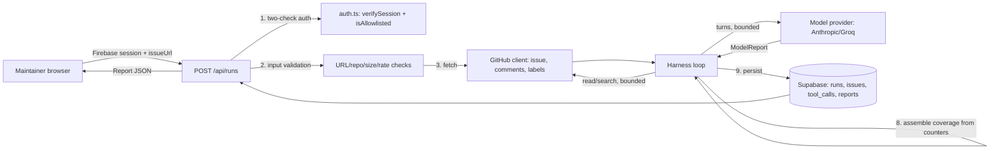

# TRD — IssueScout

**Author:** Alpha Trion (Project Assembly)
**Date:** 2026-10-08
**Status:** Approved (contract is fixed per Build Spec §0 — "treat sections 5, 6, 9 as a proposed contract unless an owner changes them")
**Companion to:** `PRD.md` (all sections cited by number below), `SCHEMA.md`, `USER-STORIES.md`

> Full-tier project. This document states *how* the system is built — architecture, authoritative interface contracts, non-functional approach, security model, technical risks. It does not restate PRD content; every requirement is cited back to a PRD section. `SCHEMA.md` holds the full data model. Individual `specs/NNN-slug.md` files hold file-level implementation detail — Shockwave cites this document's §3 rather than inventing a contract shape.
>
> **Design reference:** A human-approved, detailed Phase-1 implementation plan already exists at `/Users/jongaal/.claude/plans/what-can-u-see-wobbly-deer.md`. It resolved D2 (model provider), D3 (GitHub token), D6/D7/D8 (constants), and gives file-by-file structure, interface shapes, harness pseudocode, the zod validation approach, migration SQL, route handlers, and a build order. This TRD states the authoritative contract; that plan states one validated way to build to it. Shockwave should treat the plan as load-bearing design reference, not re-derive these decisions independently.

---

## 1. Purpose & Scope

This document covers the system architecture, the authoritative API contract (`Report`/`ModelReport` shape, the four backend endpoints active in Phase 1, the GitHub tool contract, and the harness's state machine), and the security model enforcing PRD §9's six Red-Alert-derived requirements. It defers the full column-level data model to `SCHEMA.md`, and defers file-level build sequencing to the plan referenced above and to individual specs.

**Scope of this TRD: Phase 1 only** (read-only triage). Phase 2 (`POST /api/actions/:id/decision`, the write path, `GITHUB_WRITE_TOKEN`) and Phase 3 (`/api/evals/*`) are documented in §3 for contract completeness — since Build Spec §6 defines them now — but are explicitly **not** in this build cycle's scope (PRD §10). Nothing in this cycle should be built against the Phase 2/3 rows below without a new spec explicitly unblocked on D4/D5.

---

## 2. System Architecture

**Components.**

| Component | Owns | Owner |
|---|---|---|
| Frontend (React, Next.js app directory minus `api/`) | URL submission form, report view, run history, auth UI | Ivaylo — separate branch, not started; out of scope this cycle |
| Backend API (`app/api/`, Next.js Route Handlers) | Request validation, auth enforcement, orchestrates the harness, persists results | Jonathan |
| Harness (`lib/server/harness/`) | The bounded tool-calling loop: turn/time/search/read limits, structure + content validation, coverage assembly | Jonathan |
| GitHub client (`lib/server/github/`) | All GitHub REST calls; owns the `owner/repo` hardcoding, PR/self filtering, timeout/retry | Jonathan |
| Model provider (`lib/server/model/`) | Normalizes Anthropic/Groq behind one interface; D2 swap seam | Jonathan |
| Auth (`lib/server/auth.ts`) | Firebase session verification + allowlist check, as two distinct functions | Jonathan (D9 placeholder, pending Ivaylo sign-off) |
| Database (Supabase Postgres) | `runs`, `issues`, `tool_calls`, `reports` (Phase 1); `actions`, `approvals` (Phase 2); `eval_results` (Phase 3) | Jonathan, via service-role key, backend only |
| Vercel | Hosts both frontend and backend | Shared |

**Data flow (Phase 1, one run).**



**Request lifecycle, mapped to Build Spec §8.1's 9 steps** (authoritative step numbering — specs reference these, don't renumber):

1. Input check before any model/GitHub call (`invalid_url`, `repo_not_allowed`, run-rate check).
2. Fetch issue/comments/labels (`not_found`, `is_pull_request`, `issue_too_long`).
3. Build initial messages: system prompt verbatim + issue/comments marked untrusted + label list + tool def (read/search only).
4. Turn loop: validate tool call, enforce limits, run with timeout, return result or short plain error.
5. Limit enforcement: refuse further calls of a kind at `MAX_SEARCHES`/`MAX_CANDIDATE_READS`; stop the run at `MAX_MODEL_TURNS`/`MAX_RUN_SECONDS`.
6. Structure validation: zod parse against `ModelReport`; one retry; else `model_output_invalid`.
7. Content validation: strip invented labels, un-retrieved related-issue numbers, non-sourced URLs into `coverage.removedByValidation`.
8. Coverage assembly from harness counters only — never from model output.
9. Persist run + tool calls + report; return. (Step 10, approval handling, is Phase 2 — out of scope this cycle.)

---

## 3. API / Interface Contracts

**Authoritative source.** Every spec's `Inputs/Outputs` field must match this section exactly, which in turn is lifted verbatim from Build Spec §5-§7 (the "treat as fixed" contract). If the real API turns out not to match once building starts, that's a halt-and-escalate (`[DEPENDENCY-REQUEST]`-style), not a quiet workaround.

### 3.1 Report shape (Build Spec §5)

```ts
type Category = "bug_report" | "feature_request" | "question" | "needs_clarification";
type Priority = "high" | "medium" | "low" | "needs_review" | "not_assigned";
type Assessment = "possible_duplicate" | "related" | "unlikely_match";

interface ModelReport {
  summary: string;                      // at most three sentences
  category: Category;
  categoryReason: string;
  priority: Priority;                   // "not_assigned" for feature_request and question
  priorityEvidence: string;
  priorityUncertainty: string;
  suggestedLabels: { name: string; reason: string }[];   // names from the repo's real label list only
  evidence: { observation: string; sourceUrl: string }[];
  missingInformation: string[];
  relatedIssues: {                      // at most three
    number: number; title: string; url: string;
    similarities: string; differences: string; assessment: Assessment;
  }[];
  recommendedNextStep: string;
  proposedActions: (                    // Phase 2 shape; MUST be [] in every Phase 1 report, harness-forced
    | { kind: "add_labels"; labels: string[] }
    | { kind: "post_comment"; body: string }
  )[];
  containsEmbeddedInstructions: boolean;
  limitations: string[];
}

interface Report extends ModelReport {
  issue: { number: number; title: string; url: string; state: string; retrievedAt: string };
  coverage: {                           // written by the harness, NEVER by the model
    searchesRun: number; searchesFailed: number; candidatesRead: number;
    commentsTruncated: boolean;
    stopReason: "completed" | "search_limit" | "read_limit" | "turn_limit" | "time_limit" | "tool_failure";
    removedByValidation: string[];      // items dropped in step 7
  };
}
```

**Phase-1 invariant (not in the Build Spec's type alone — a build-time enforcement rule):** regardless of what the model emits in `proposedActions`, the harness overwrites it to `[]` immediately before persisting/returning, in Phase 1. A spec implementing the harness's final-report assembly step must include this overwrite explicitly, not rely on the model happening to comply.

### 3.2 Backend endpoints (Build Spec §6) — Phase 1 active rows

All responses are JSON, camelCase. All endpoints require a signed-in, allowlisted user (two distinct checks — see §5 below). This cycle builds only the Phase-1 rows; Phase 2/3 rows are listed for contract completeness and must not be built against yet.

| Method & path | Body | Returns | Phase | This cycle? |
|---|---|---|---|---|
| `POST /api/runs` | `{ issueUrl }` | `{ runId, status, report?, error? }` | 1 | **Yes** |
| `GET /api/runs/:id` | none | the run, its report, its actions | 1 | **Yes** |
| `GET /api/runs?limit=` | none | recent runs, newest first, **caller's own runs only** | 1 | **Yes** |
| `POST /api/actions/:id/decision` | `{ decision: "approve" \| "reject", editedContent? }` | the action with new status + write result | 2 | No — blocked on D4/D5 |
| `POST /api/evals/run` | none | `{ evalRunId }` | 3 | No |
| `GET /api/evals/:id` | none | per-case expected/actual/pass-fail | 3 | No |

**Error shape** (every endpoint, every phase): `{ error: { code, message } }`.

**Error codes:** `invalid_url`, `repo_not_allowed`, `is_pull_request`, `not_found`, `issue_too_long`, `rate_limited`, `timeout`, `github_error`, `model_output_invalid`, `turn_limit`, `time_limit`, `unauthorized`, `run_rate_limited`, `write_failed`.

`message` is plain language for the user. It MUST NOT contain stack traces, tokens, or raw upstream errors — this is a hard constraint on every error path, not just the top-level catch.

**`GET /api/runs/:id` ownership contract (PRD §9 finding #2, US-5):** returns the run only if `run.user_id === requestingUser.id`. Any other case — run doesn't exist, or exists but belongs to someone else — returns the *same* response shape (`not_found` or `unauthorized`; pick one and apply consistently) so that existence of another user's run is never distinguishable from non-existence. This is an explicit check in the route handler, separate from and after the "is this user signed in and allowed" check — never inferred from it.

### 3.3 The GitHub tool (Build Spec §7)

The model is given exactly one tool, `github_issue_research`, with two operations. No write operation exists in the tool definition exposed to the model, in any phase — this is a schema-level fact, not a convention the prompt asks the model to respect.

| Operation | GitHub call | Called by | Returns | Model-facing? |
|---|---|---|---|---|
| `read` (issue) | `GET /repos/{owner}/{repo}/issues/{number}` | model, harness | title, body, number, state, labels, timestamps, URL, retrieval status | Yes |
| `read` (comments) | `GET /repos/{owner}/{repo}/issues/{number}/comments` | harness, with each issue read | up to 20 comments, timestamps, links, truncation status | No (harness-internal, bundled into the issue read) |
| `read` (labels) | `GET /repos/{owner}/{repo}/labels` | harness only | label names + descriptions | No |
| `search` | `GET /search/issues` with `repo:` and `is:issue` | model | up to 10 candidates: number, title, excerpt, state, URL, coverage status | Yes |
| write: add labels | `POST /repos/{owner}/{repo}/issues/{number}/labels` | harness only, post-approval | confirmation/error | No — Phase 2, not built this cycle |
| write: post comment | `POST /repos/{owner}/{repo}/issues/{number}/comments` | harness only, post-approval | confirmation/error | No — Phase 2, not built this cycle |

**Rules enforced in code, not the prompt:**
- The harness sets `owner/repo`; the tool schema exposed to the model has no `owner`/`repo` parameter. `APPROVED_REPO` for all Phase-1 reads/search.
- Pull requests (`pull_request` field present) and the input issue itself are filtered from every search result before it reaches the model.
- The harness never fetches a URL found inside issue/comment text — all GitHub URLs are constructed only from (owner, repo, number) tuples the harness controls.

**Limits (harness-enforced, not prompt-enforced):**

| Constant | Value |
|---|---|
| `MAX_SEARCHES` | 3 |
| `MAX_SEARCH_RESULTS` | 10 |
| `MAX_CANDIDATE_READS` | 5 |
| `MAX_COMMENTS_PER_ISSUE` | 20 |
| `REQUEST_TIMEOUT_SECONDS` | 20 |
| `MAX_RETRIES_PER_REQUEST` | 1 |
| `MAX_MODEL_TURNS` | 15 (starting value) |
| `MAX_RUN_SECONDS` | 120 (starting value) |
| `MAX_FORMAT_RETRIES` | 1 |
| `ISSUE_MAX_CHARS` | 20000 (D6) |
| `MAX_OUTPUT_TOKENS` | 4000 (D7) |
| `RUNS_PER_USER_PER_HOUR` | 10 (D8) |

On a GitHub rate limit: stop making GitHub calls for the remainder of that run; report the failure in `coverage.searchesFailed`, never silently convert it to "zero matches" (PRD §9 Observability; Build Spec §8.1 step 8; US-3).

### 3.4 System prompt (Build Spec §10)

Fixed, used verbatim. Changes require both owners' agreement — this is not a tunable a spec may rephrase. See Build Spec §10 for the full text; TRD does not duplicate it here since the Build Spec is already the authoritative verbatim source and restating it risks drift between two "authoritative" copies.

---

## 4. Non-Functional Approach

*How* each PRD §9 target gets hit — not a restatement of the targets.

| PRD §9 target | Technical approach |
|---|---|
| Run completes/stops/fails within `MAX_RUN_SECONDS=120` | Harness loop checks elapsed time every turn; hard-stops and returns a partial report naming `stop_reason: "time_limit"` rather than letting the process run unbounded. |
| Individual calls bounded by `REQUEST_TIMEOUT_SECONDS=20`, `MAX_RETRIES_PER_REQUEST=1` | Every GitHub/model HTTP call wrapped in `AbortController`; exactly one retry on network failure only (never on 4xx, which is a validation/auth problem a retry can't fix). |
| Two distinct auth checks (PRD §9 #1) | `auth.ts` exposes `verifySession(req)` and `isAllowlisted(email)` as two separate functions called in sequence in every route handler — never one combined `isAuthorized()` that conflates them. See §5. |
| Per-resource ownership check / IDOR prevention (PRD §9 #2) | `GET /api/runs/:id` queries `WHERE id = :id AND user_id = :requestingUserId` — the ownership check is in the query predicate itself, not a separate app-level comparison after an unscoped fetch (removes a class of "forgot to check" bugs). |
| RLS as defense-in-depth (PRD §9 #4) | See SCHEMA.md — policies defined on all four Phase-1 tables scoped to `user_id = auth.uid()` equivalent, even though the service-role key bypasses them for today's only caller. |
| CORS allowlist, strict (PRD §9 #5) | `CORS_ALLOWED_ORIGINS` read from env as a comma-split explicit list; every route handler checks the request `Origin` header against it before processing, reject otherwise. No default-allow, no wildcard, ever. |
| Observability — logs never contain raw content | `logger.ts` exposes a typed `logRunEvent(runId, event, meta)` where `meta` is a constrained shape (counts, codes, IDs) — there is no code path that accepts a free-text/body field, so "accidentally logged the issue body" is structurally prevented, not just a reviewed convention. |
| Reliability — never a blank result | Every harness exit path (success, each error code, each limit stop) returns a typed `Report` or a typed error object; no path returns `undefined`/`null` as the terminal value of `runHarness()`. |

---

## 5. Security Requirements

**Auth model.** Firebase Auth (D9 — placeholder pending Ivaylo's explicit confirmation per PRD §11/§12) sits behind one interface (`lib/server/auth.ts`) so a provider swap later touches one file, not every route handler. Two checks, always both, always in this order:

1. `verifySession(req)` — is there a valid Firebase session token on this request? Fails closed (`unauthorized`) if not. This check alone says nothing about whether the identity is *allowed* to use the app.
2. `isAllowlisted(email)` — is this verified identity's email present in `ALLOWED_USER_EMAILS`? Fails closed (`unauthorized`, or a distinguishable "not authorized" response per APPFLOW.md's Not-authorized screen) if not.

A signed-in-but-not-allowlisted user is rejected by check 2, explicitly — never allowed through because check 1 passed. This is PRD §9 finding #1, Red-Alert's highest-severity finding, and US-1's binding acceptance criteria. Any spec implementing a route handler MUST show both checks as separate function calls, not a combined guard.

**Per-resource authorization.** Every endpoint returning a specific resource (`GET /api/runs/:id` in Phase 1; any future per-action endpoint in Phase 2) scopes its query by the requesting user's ID, not merely by "is this user signed in and allowed" (PRD §9 finding #2, US-5). See §4's query-predicate approach above.

**Secrets.** `GITHUB_READ_TOKEN`, model API key(s), Supabase service-role key: backend env vars only. Never in code, commits, prompts, model context, logs, README, or any browser-visible payload (PRD §9, Build Spec §4). `GITHUB_WRITE_TOKEN` must not exist anywhere in this cycle — PRD §9 finding #3 gates its creation on D5 being finalized, which is explicitly out of scope this cycle.

**CORS.** Non-wildcard explicit allowlist, server-enforced on every request (PRD §9 finding #5) — see §4.

**RLS.** Defined on all Phase-1 tables as defense-in-depth independent of the service-role key bypass (PRD §9 finding #4) — see SCHEMA.md §Row Level Security.

**Content safety / injection.** Issue/comment text is wrapped and marked as untrusted data in the prompt (Build Spec §8.1 step 3); embedded instructions are flagged (`containsEmbeddedInstructions`) but the actual defense is architectural — the model has no write-capable tool in its schema, in any phase, so following an embedded instruction cannot cause a GitHub mutation (Build Spec §8.2; this is the same INJECTION discipline the agent suite itself follows). Model output is rendered as plain escaped text only, never HTML/Markdown (Build Spec §8.2, DESIGN-BRIEF.md §3) — relevant to backend-side response assembly even before frontend rendering exists.

**LLM-backed feature.** This is an LLM-backed feature (tool-calling harness against Claude/Groq) — `.claude/skills/ai-feature-rules/SKILL.md` applies to the model client, prompt handling, and limit enforcement. Red Alert Mode 2 checks the diff against this skill in addition to the standard security checklist.

**Retention.** No retention/deletion stance yet exists for quoted third-party GitHub text stored in `reports.report`'s evidence fields (PRD §9 finding #6, US-8) — open escalation, not resolved by this document or this build cycle. Flag again at CLOSE if still unwritten.

---

## 6. Technical Risks & Assumptions

| Risk/Assumption | Impact if wrong | How we'd find out |
|---|---|---|
| Model provider swap (Anthropic ↔ Groq) preserves tool-calling/JSON-structure behavior closely enough that the same harness code works against both | Groq run silently produces malformed tool calls or unparseable final answers, surfacing as spurious `model_output_invalid` or dropped turns | zod structure validation (step 6) catches this regardless of provider by design — a provider-specific failure shows up as an elevated `model_output_invalid` rate specifically on Groq-routed runs, visible in logged outcomes |
| D9 (Firebase + allowlist) ships as a placeholder without Ivaylo's explicit sign-off before Phase 1 is called done | The two-check auth gate — the mechanism enforcing PRD's two highest-severity Red-Alert findings — is unconfirmed by the second owner on a two-person project | PRD §12 Definition of Done already gates "Phase 1 complete" on this; tracked as an open item until Ivaylo confirms |
| Service-role key bypasses RLS for 100% of today's traffic, so RLS policies are untested by any real caller | A misconfigured RLS policy goes unnoticed until a non-service-key caller (eval tooling, a debugging session) actually hits it, possibly in a way that either over- or under-restricts | US-7's acceptance criterion requires an explicit test: attempt a read/write as a non-service-role role and confirm denial — this must be run deliberately, not assumed from "the policy exists" |
| `MAX_MODEL_TURNS=15` / `MAX_RUN_SECONDS=120` are stated as "starting values" (Build Spec §7) | Too low: legitimate runs get cut short, degrading report quality. Too high: a misbehaving model run consumes more cost/time than intended | Run completion rate (PRD §4 target: ≥19/20) and `stop_reason` distribution in the `runs` table are the direct signal; adjust the constant, not the enforcement logic, if the data says so |
| `calcom/cal.diy` is a real repository with real contributors' text flowing into `reports` | A broader-than-allowlist deployment without a stated retention stance stores real people's comments indefinitely by default, without anyone having decided that on purpose | PRD §9 finding #6 / US-8 names this as a blocking open item for any deployment wider than the current closed allowlist — tracked, not silently resolved |
| Next.js API routes run `POST /api/runs` synchronously for up to 120s (no queue, per the build plan's explicit "don't over-engineer" calibration) | On Vercel, a serverless function with a long synchronous execution risks platform-level timeout limits that differ from the app's own `MAX_RUN_SECONDS` | Confirm Vercel's function-duration limit for the deployed plan against `MAX_RUN_SECONDS=120` before first real deploy — if the platform limit is lower, the app's own limit is moot and needs lowering to match, not the other way around |

---

## Drift discipline

If the real implementation diverges from this document, that's a flagged gap for Jazz's context audit (same "Clash" check it runs against the wiki), not a silent update. Update this file when the divergence is intentional (e.g., D1 formally resolved to a specific framework beyond "Next.js API routes," already evidenced by the `issuescout/` scaffold existing); flag it when it isn't.
